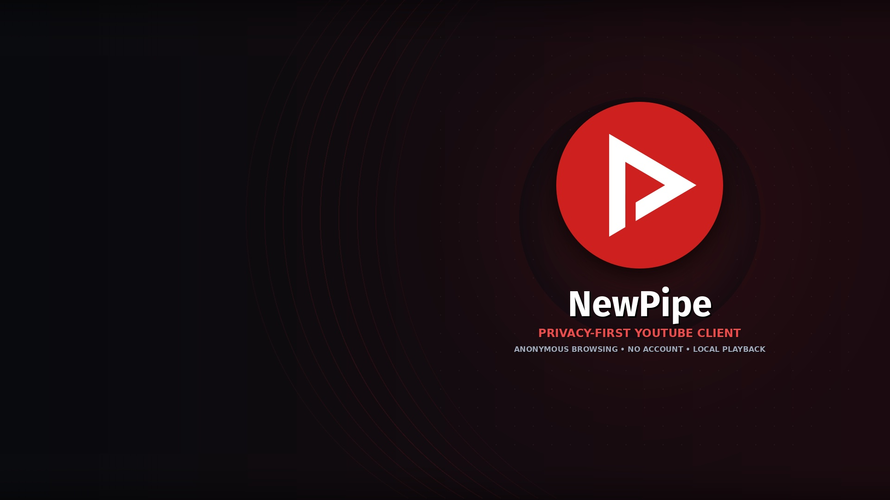
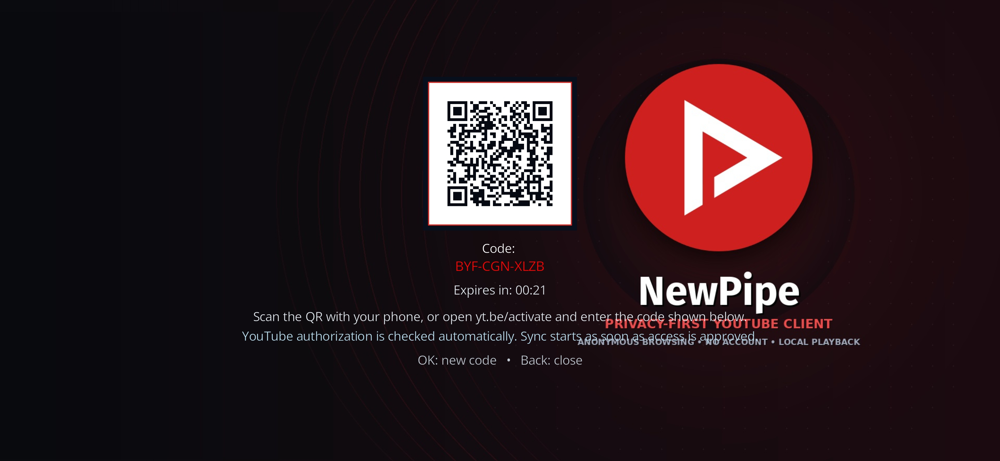

# NewPipe MOD for Kodi

> Privacy-first YouTube client for Kodi — original upstream by [Twilight0](https://github.com/Twilight0/plugin.video.newpipe), maintained here as **NewPipe MOD** by **@TrainAgain2**.

NewPipe MOD lets Kodi browse and play publicly available YouTube content without an API key or a mandatory account. Search history, watch history, bookmarks and locally stored subscriptions stay on the device.

## Version 1.4.56 — highlights

- **Shorts menu:** a dedicated main-menu entry that reads the real public YouTube Shorts surface rather than running a text search for “Shorts”.
- **Fresh discovery menus:** Trending, Live, Trailers, Random Music and Shorts request fresh data whenever opened. Kodi on-disc folder caching is disabled for these views.
- **Random Music:** each opening creates a new shuffled discovery mix from separate official-video, new-release, live-session and independent-artist queries; duplicate songs and long mix/playlist spam are filtered.
- **Trailer defaults:** English/original trailer search and a configurable resolution ceiling up to **4K**. Direct playback defaults to **1080p** while preserving the available 360p, 480p, 720p, 1440p and 4K options.
- **YouTube account linking:** a dedicated Kodi QR panel over the add-on fanart, with the QR code, activation code and a **60-second** live countdown in a fixed layout. Authorization is checked automatically and subscriptions synchronize after approval.
- **Original audio for subscriptions:** when a subscribed video provides multiple HLS audio tracks, the add-on selects the track explicitly labelled **original** (for example, Spanish – original). All other YouTube-provided audio languages remain available from Kodi's **Audio stream** menu.
- **No external resolver dependency:** bundled libraries resolve a direct YouTube stream locally; no `plugin.video.youtube` or external `script.module.*` package is required.

## Installation

1. Download `plugin.video.newpipe-1.4.56.zip` from the [v1.4.56 release](../../releases/tag/v1.4.56).
2. In Kodi, select **Add-ons → Install from zip file** and choose the downloaded ZIP.
3. Open **NewPipe MOD** from Video add-ons.
4. Optional: open **YouTube account** to link an account using the QR code. The subscription import begins automatically after approval.

> Install this MOD over an older NewPipe MOD release to retain preferences. Existing settings can remain in the Kodi profile; choose **Defaults** in the add-on settings if the new trailer/direct-quality defaults should be restored.

## Requirements

- Kodi **20+** (tested on Kodi 21.3 / Android ARM64).
- `inputstream.adaptive` is used automatically for HLS playback when installed and enabled.
- Network access to public YouTube endpoints.

## Privacy and account data

- Anonymous browsing does not use an account.
- Optional YouTube linking stores its session token only inside the local Kodi add-on profile.
- Local subscriptions, bookmarks and history are JSON files in the same local profile. Removing the add-on/profile removes them.

## Attribution and license

This repository preserves the original author credit, upstream link and licensing notices. See [MOD-ATTRIBUTION.md](MOD-ATTRIBUTION.md) and the bundled [LICENSES](LICENSES/) directory. The add-on is distributed under **GPL-3.0-only**.

## Changelog

Full version history: [changelog.txt](changelog.txt).
